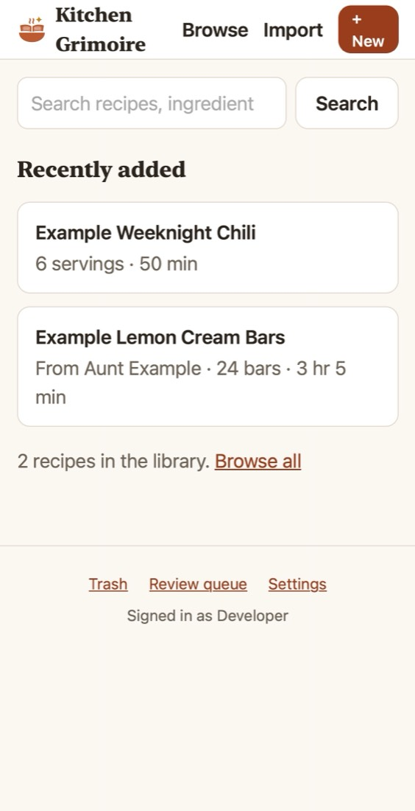
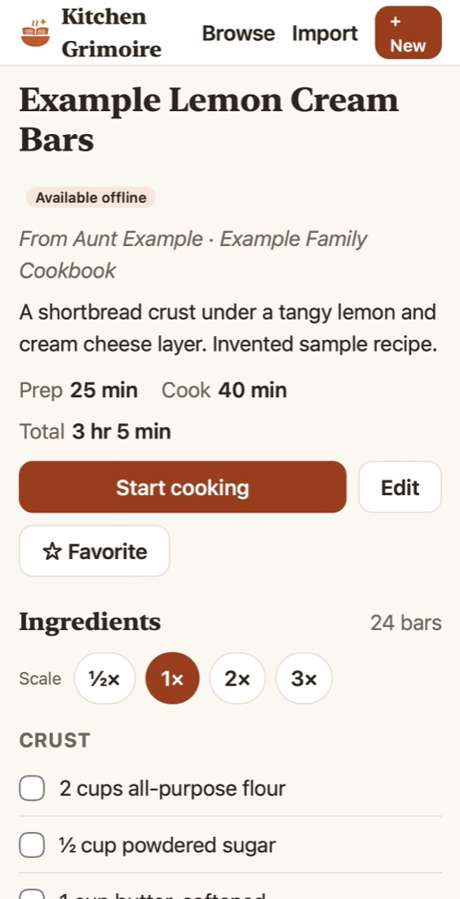
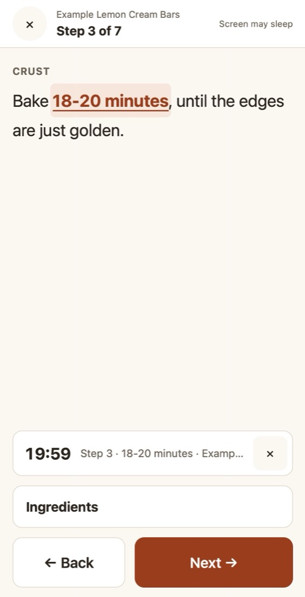
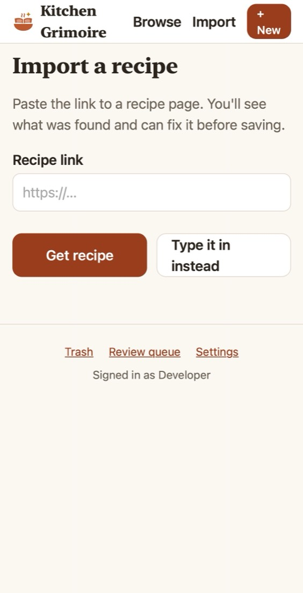

<h1 align="center">
  <picture>
    <source media="(prefers-color-scheme: dark)" srcset="docs/assets/logo-header-dark.svg">
    <source media="(prefers-color-scheme: light)" srcset="docs/assets/logo-header.svg">
    
  </picture>
</h1>

<p align="center"><em>The family recipe book, kept safe and open on the counter.</em></p>

A self-hosted recipe library for one household: a single static Go binary with a
mobile-first web UI, behind your own single sign-on. Import recipes from links, type
them in on a phone, or bulk-load a family cookbook, and never silently lose the
original wording, who a recipe came from, or an earlier version.

## Status

**Before 1.0.** Manual entry, URL import, browser and phone capture for sites that
block servers, search, cook mode, the PWA, backups, and bulk import and export
(including the legacy cookbook converter) are built. 1.0 follows the maintainer's
sign-off of each phase ([plan](docs/DESIGN.md#19-plan)). Each release tag `vX.Y.Z` publishes a
multi-architecture image to `ghcr.io/runlevel-six/kitchen-grimoire`.

## What it does

- **Phone first.** Big tap targets, one column on a phone, installable on the home
  screen, and recipes you've opened stay readable offline.
- **Cook mode.** One step at a time in large type, the screen kept awake, tap-to-start
  timers for the times in each step, and ingredients to tick off.
- **Import from a link.** Paste a recipe page's address; schema.org data (JSON-LD or
  Microdata) fills in the editor for you to check before saving. No per-site scrapers.
- **Fast entry.** One ingredient per line, a blank line between steps, named groups
  ("Crust", "Filling"), hierarchical categories, tags, and phone-camera photos.
- **Scaling.** ½×, 2×, 3×; only amounts it understood are scaled, and anything else is
  marked "not scaled" rather than guessed.
- **Search.** Full-text search across titles, ingredients, steps, notes, and people, with
  prefix matching, phrases, exclusions, and browsing by category, person, collection,
  and tag.
- **Nothing is lost.** Every save is a revision you can restore; imports keep their
  original text and source data; deletes go to a 30-day trash.
- **Family collections.** A separate converter turns a long word-processor cookbook into
  reviewable recipes, with a review queue for anything it wasn't sure about.
- **Portable and boring to run.** One binary, one SQLite file plus photos, scheduled and
  verified backups, Prometheus metrics, and a full export in schema.org JSON-LD.

<p align="center">
  
  
  
  
</p>
<p align="center"><sub>Screenshots use invented sample recipes.</sub></p>

## Quick start

To try it on your own computer with no sign-in (development mode), you need Go and
`make`:

```sh
git clone https://github.com/runlevel-six/kitchen-grimoire.git
cd kitchen-grimoire
make dev
```

Then open <http://localhost:8080>. Two invented sample recipes are added to the empty
database. [Your first run](docs/tutorials/first-run.md) walks through it, including
opening it on your phone.

To run it for real, behind an SSO proxy such as Authelia, follow
[Deploy on Kubernetes](docs/tutorials/deploy-on-kubernetes.md). A Kustomize base is in
[`deploy/base`](deploy/base) and a Docker Compose example in
[`deploy/compose`](deploy/compose).

## Documentation

The [documentation index](docs/README.md) has reading paths for each kind of reader.

| | |
|---|---|
| Tutorials | [Your first run](docs/tutorials/first-run.md) · [Deploy on Kubernetes](docs/tutorials/deploy-on-kubernetes.md) |
| Using it | [Add and edit recipes](docs/how-to/add-and-edit-recipes.md) · [Import from a link](docs/how-to/import-a-recipe-from-a-link.md) · [Cook mode](docs/how-to/use-cook-mode.md) · [Find recipes](docs/how-to/find-recipes.md) · [Review imports](docs/how-to/review-imported-recipes.md) |
| Running it | [Back up and restore](docs/how-to/backup-and-restore.md) · [Operate](docs/how-to/operate.md) · [Upgrade](docs/how-to/upgrade.md) · [Make someone an admin](docs/how-to/make-someone-an-admin.md) · [Bulk import and export](docs/how-to/bulk-import-and-export.md) · [Import a legacy collection](docs/how-to/import-a-legacy-collection.md) |
| Reference | [Configuration](docs/reference/configuration.md) · [Command line](docs/reference/cli.md) · [HTTP routes](docs/reference/http-routes.md) · [Search syntax](docs/reference/search-syntax.md) · [Interchange format](docs/reference/interchange-format.md) · [Metrics](docs/reference/metrics.md) |
| Background | [How it's built](docs/explanation/architecture.md) · [Security model](docs/explanation/security-model.md) · [Data preservation](docs/explanation/data-preservation.md) · [Design document](docs/DESIGN.md) |

## Development

```sh
make hooks     # once per clone: pre-commit checks (private-data denylist, betterleaks)
make dev       # the server on :8080 with auth off, data in local/data
make test      # Go tests
make check     # everything CI's check job runs
```

[`docs/DESIGN.md`](docs/DESIGN.md) is the source of truth for what to build and why,
and [`docs/status.md`](docs/status.md) logs what was built when.

## License

Apache-2.0. See [LICENSE](LICENSE) and [NOTICE](NOTICE).
